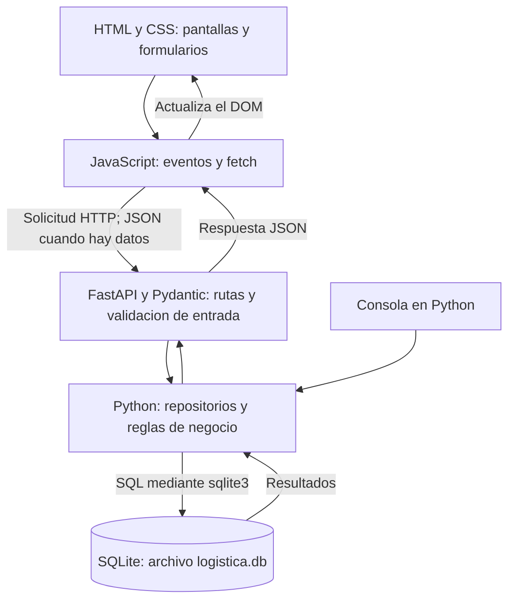

# Guía de defensa: tecnologías de la implementación

[Índice de documentación](../README.md)

## Explicación inicial

> Implementamos una aplicación por capas. El frontend utiliza HTML, CSS y JavaScript para presentar las pantallas e interactuar con el usuario. El backend está desarrollado en Python y contiene las reglas del negocio. FastAPI expone esas operaciones mediante una API HTTP, que ejecutamos con Uvicorn. La información se guarda en SQLite y la consultamos con SQL mediante el módulo sqlite3 de Python.

Las tecnologías y los usos de esta guía se verificaron en el código y en los archivos de dependencias. Los motivos de elección se presentan como **justificaciones técnicas coherentes con la implementación**, no como un registro de las decisiones históricas del equipo.

## Cómo se conecta todo

Uvicorn es el servidor que ejecuta la aplicación FastAPI y atiende las conexiones HTTP. La propia aplicación también publica los archivos de `Frontend` mediante `StaticFiles`, por lo que interfaz y API se acceden desde el mismo origen.

### Cómo explicar la relación entre Uvicorn, la API y el backend

**La API forma parte del backend: es su puerta de entrada HTTP para la interfaz web.** El backend también incluye los repositorios, las reglas del negocio y el acceso a los datos.

Uvicorn es el servidor que ejecuta la aplicación FastAPI y atiende las conexiones. FastAPI define las rutas de la API, recibe las solicitudes y delega las operaciones en los repositorios de Python.

En el navegador, HTML y CSS definen la estructura y la apariencia de las pantallas. JavaScript se encarga de enviar solicitudes a la API y mostrar sus respuestas.

El recorrido de una operación es:

**Interfaz → JavaScript → API → lógica del negocio en Python → SQLite.**

La respuesta vuelve desde los repositorios hacia la API, que devuelve JSON; JavaScript interpreta esos datos y actualiza la pantalla. Uvicorn atiende el intercambio HTTP entre el navegador y la aplicación.

Por ejemplo, al confirmar un pedido, JavaScript envía un `POST /pedidos/{identificador}/confirmar`. La API llama al repositorio de pedidos, que verifica las existencias y cambia el estado si corresponde. La respuesta permite mostrar el pedido confirmado o informar los faltantes.

En esta implementación, la aplicación también entrega los archivos HTML, CSS y JavaScript desde el mismo servidor. Así, el navegador puede cargar la interfaz y consultar la API usando el mismo origen.

**Frase para la defensa:**

> Uvicorn ejecuta nuestro servidor web. FastAPI expone las operaciones del backend mediante una API, que la interfaz consulta usando JavaScript. La API delega las reglas del negocio y el acceso a SQLite en los repositorios de Python.

## Tecnologías principales

### Python: lenguaje del backend y de la consola

**Para qué lo usamos:** representar las entidades y ejecutar la lógica del sistema: validaciones, stock, reservas, asignación de vehículos, despacho y entrega. También permite operar mediante un menú de consola.

**Qué hace en este proyecto:** las clases de `Backend/modelos` representan productos, pedidos, depósitos, vehículos, conductores y entregas. Los repositorios `InventarioSQLite`, `PedidosSQLite` y `FlotaSQLite` coordinan las operaciones persistentes y las transacciones.

**Cómo justificarlo:** su sintaxis facilita leer y explicar las reglas del dominio; permite organizar el programa con clases y reutilizar la misma lógica desde la web y la consola. Su biblioteca estándar incluye acceso a SQLite.

**Frase para la defensa:** “Python concentra las reglas del negocio. La interfaz puede cambiar, pero validar stock y despachar correctamente siguen siendo responsabilidades del backend”.

### HTML: estructura de las pantallas

**Para qué lo usamos:** definir formularios, campos, tablas, botones, títulos y navegación.

**Qué hace en este proyecto:** los archivos `index.html`, `gestion.html`, `cargas.html` y `seguimiento.html` organizan las pantallas Inicio, Gestión, Cargas y Seguimiento.

**Cómo justificarlo:** es el lenguaje que interpreta el navegador para estructurar la interfaz. Sus controles y elementos semánticos permiten construir los formularios y tablas que necesita el sistema.

**Frase para la defensa:** “HTML define qué elementos contiene cada pantalla y cómo se organiza su contenido”.

### CSS: presentación y adaptación visual

**Para qué lo usamos:** dar formato y distribuir los elementos: colores, tamaños, espacios, tarjetas, tablas y estados visuales.

**Qué hace en este proyecto:** `Frontend/styles.css` reúne los estilos compartidos, usa Flexbox y reglas `@media`, y contempla mensajes de error, foco de controles y tablas desplazables.

**Cómo justificarlo:** separar estilos y estructura facilita mantener una apariencia consistente entre pantallas y adaptar la distribución a distintos anchos.

**Frase para la defensa:** “CSS controla la presentación y permite que las pantallas compartan el mismo diseño y se adapten al tamaño disponible”.

### JavaScript: comportamiento de la interfaz

**Para qué lo usamos:** responder a eventos, leer formularios, consultar la API y actualizar la pantalla.

**Qué hace en este proyecto:** los scripts usan `addEventListener`, `async/await` y el DOM. Consultan productos y pedidos, completan selectores, muestran resultados y bloquean botones mientras se procesa una operación. `api.js` reúne funciones compartidas de comunicación y presentación.

**Cómo justificarlo:** JavaScript se ejecuta en el navegador y ofrece las herramientas necesarias para estas interacciones. Usarlo de forma nativa mantiene una interfaz de este alcance con archivos directos y sin un proceso de compilación del frontend.

**Frase para la defensa:** “JavaScript conecta los controles de la pantalla con la API y muestra el resultado de las operaciones”.

### FastAPI: framework para la API HTTP

**Para qué lo usamos:** ofrecer las operaciones del backend a la interfaz web mediante rutas HTTP.

**Qué hace en este proyecto:** `Backend/api.py` define rutas como `GET /productos`, `POST /pedidos` y `POST /pedidos/{identificador}/confirmar`. Recibe solicitudes, delega en los repositorios y devuelve datos JSON. También traduce errores a respuestas HTTP y ofrece documentación interactiva en `/docs`.

**Cómo justificarlo:** permite definir rutas con poco código repetitivo, integrar modelos de entrada y generar documentación de los endpoints. Deja las reglas logísticas en los repositorios, compartidas con la consola.

**Frase para la defensa:** “FastAPI publica las operaciones del backend para que el navegador pueda utilizarlas mediante HTTP”.

### Pydantic: modelos y validación de entrada

**Para qué lo usamos:** definir el formato esperado de los datos recibidos por la API y detectar entradas inválidas.

**Qué hace en este proyecto:** modelos como `ProductoEntrada`, `PedidoEntrada` e `ItemEntrada` establecen campos y restricciones. Por ejemplo, una cantidad debe ser un entero positivo y la prioridad debe estar entre 1 y 3. La configuración rechaza campos extra.

**Cómo justificarlo:** centraliza reglas de formato y tipos, evita repetir comprobaciones básicas en cada endpoint y contribuye al esquema de documentación de la API.

**Distinción importante:** validar el formato de una cantidad no demuestra que haya stock. La disponibilidad, la capacidad y las transiciones se comprueban además en el backend. Los modelos Pydantic de entrada tampoco reemplazan a las entidades de dominio como `Pedido`.

**Frase para la defensa:** “Pydantic valida la estructura de lo que recibimos; los repositorios validan si la operación es válida para el negocio”.

### Uvicorn: servidor que ejecuta la aplicación web

**Para qué lo usamos:** iniciar y mantener la aplicación accesible por HTTP.

**Qué hace en este proyecto:** al ejecutar `python -m uvicorn Backend.api:app --host 127.0.0.1 --port 8000`, carga el objeto `app` y atiende las conexiones dirigidas a esa dirección y puerto. Uvicorn es un servidor ASGI; ASGI es la interfaz de comunicación que utiliza para ejecutar la aplicación.

**Cómo justificarlo:** es compatible con FastAPI y permite iniciar la aplicación local con un comando. El mismo servicio entrega la API y los archivos del frontend.

**Frase para la defensa:** “FastAPI define la aplicación y sus rutas; Uvicorn es el servidor que la pone a funcionar y recibe las conexiones”.

### SQLite y SQL: almacenamiento persistente

**Para qué los usamos:** conservar productos, existencias, pedidos y flota al cerrar y volver a abrir el programa.

**Qué hacen en este proyecto:** SQLite es el motor de base de datos; `Backend/logistica.db` es el archivo predeterminado. SQL es el lenguaje usado para crear tablas, consultar con `SELECT` y `JOIN`, e insertar o actualizar registros. `Backend/schema.sql` define las tablas y sus restricciones.

**Cómo justificarlos:** SQLite permite una base relacional local sin configurar un servicio de base de datos independiente. Eso facilita instalar y demostrar el trabajo. Sus transacciones, claves foráneas y restricciones ayudan a mantener los datos consistentes.

**Criterio de alcance:** esta elección corresponde a una aplicación local. Un escenario con mucha concurrencia de escritura o despliegue distribuido requeriría reevaluar la persistencia.

**Frase para la defensa:** “SQLite nos permite persistir la información en un archivo y aplicar relaciones y transacciones, con una instalación adecuada para el alcance local del proyecto”.

### sqlite3: conexión entre Python y SQLite

**Para qué lo usamos:** ejecutar las consultas SQL y gestionar conexiones y transacciones desde Python.

**Qué hace en este proyecto:** `InventarioSQLite` abre la conexión con `sqlite3.connect`, habilita claves foráneas mediante el esquema y comparte esa conexión con los repositorios de pedidos y flota durante una operación. Las escrituras se agrupan en transacciones con `BEGIN IMMEDIATE` y rollback ante errores.

**Cómo justificarlo:** está incluido en Python y permite trabajar directamente con SQL. El código deja explícitas las consultas y las operaciones que deben confirmarse o revertirse juntas. Los valores se pasan como parámetros a las consultas.

**Frase para la defensa:** “SQLite es la base; sqlite3 es el módulo que nos permite utilizarla desde Python”.

## Comunicación: HTTP, JSON y fetch

Son tres piezas distintas del intercambio entre interfaz y backend:

| Pieza | Función en el proyecto | Justificación |
|---|---|---|
| HTTP | Transporta solicitudes y respuestas. `GET` consulta datos; `POST` realiza operaciones como crear o confirmar pedidos. | Define una forma estándar de acceder a las operaciones y comunicar resultados mediante códigos de estado. |
| JSON | Representa los datos intercambiados: identificadores, cantidades, listas de productos y pedidos. | Es un formato que la interfaz JavaScript y el backend pueden procesar directamente. |
| `fetch` | Función del navegador que envía solicitudes HTTP. `apiFetch` la utiliza y maneja las respuestas y errores. | Resuelve la comunicación necesaria utilizando funciones disponibles en el navegador. |

`async/await` permite esperar el resultado de estas solicitudes sin bloquear toda la interfaz. No significa que una operación se complete instantáneamente: los botones se bloquean mientras está pendiente y los errores se presentan al usuario.

## Arquitectura: una decisión que conviene destacar

Separamos presentación, API, reglas del negocio y persistencia. Dentro de los repositorios, las reglas y las consultas SQL se coordinan juntas; no existe una capa ORM independiente.

La web y la consola reutilizan `InventarioSQLite`, `PedidosSQLite` y `FlotaSQLite`. La consola llama a esos repositorios directamente; la web lo hace a través de la API.

Esto reduce la duplicación: confirmar un pedido debe respetar las mismas condiciones desde cualquiera de las dos interfaces. La validación del navegador mejora la experiencia, pero el backend conserva la autoridad sobre las operaciones.

La programación orientada a objetos se utiliza para representar entidades y agrupar operaciones. También aparecen secuencias imperativas, consultas declarativas en SQL y transformaciones de colecciones. No hace falta presentar toda la aplicación como un único paradigma.

## Herramientas para comprobar y reproducir el trabajo

| Herramienta | Qué hace y para qué se usa | Por qué tiene sentido |
|---|---|---|
| pytest | Ejecuta pruebas automatizadas de modelos, repositorios, consola y API. Sus fixtures preparan escenarios y bases temporales. | Permite repetir los mismos casos y detectar regresiones sin usar la base de trabajo. |
| TestClient y HTTPX | El `TestClient` de FastAPI utiliza HTTPX como cliente para probar solicitudes y respuestas de la API. | Permite comprobar endpoints y errores sin operar manualmente la interfaz ni iniciar un servidor de red para esos casos. |
| Playwright y Chromium | Automatizan un navegador para probar formularios, navegación y el circuito completo con el servidor. | Comprueban la integración real de HTML, JavaScript, API y base de datos. |
| Coverage.py | Mide qué líneas y ramas de Python ejecutan las pruebas. | Ayuda a identificar partes no ejercitadas. El porcentaje por sí solo no garantiza ausencia de errores. |
| Ruff | Revisa las reglas de docstrings configuradas en `ruff.toml`. | Mantiene una convención de documentación. En este proyecto la selección es `D`; no debe presentarse como una auditoría de todas las reglas de estilo. |
| venv | Crea el entorno `.venv` para las dependencias Python del proyecto. | Aísla sus paquetes de los de otros proyectos. |
| pip y requirements | Instalan las dependencias declaradas y sus versiones fijadas. | Facilitan reconstruir el entorno en las computadoras del equipo. |
| Git y GitHub | El repositorio mantiene versiones del código y permite compartirlo y clonarlo. | Facilitan coordinar el trabajo y conservar el historial de cambios. |

Las dependencias principales y las de pruebas se declaran en `requirements.txt`, `requirements-test.txt` y `requirements-browser.txt`. También hay paquetes de soporte instalados por estas bibliotecas, como Starlette; no es necesario presentar cada dependencia indirecta como una elección independiente de arquitectura.

## Ejemplo: qué pasa al crear un pedido

1. HTML presenta el formulario y CSS le da formato.
2. JavaScript escucha el envío y obtiene los valores ingresados.
3. `fetch` envía un `POST /pedidos` con los datos representados en JSON.
4. Uvicorn recibe la conexión y ejecuta la aplicación FastAPI.
5. FastAPI utiliza `PedidoEntrada` de Pydantic para validar la entrada.
6. La API llama a `PedidosSQLite`, que ejecuta las reglas de creación.
7. El repositorio utiliza `sqlite3` y SQL para guardar el borrador en SQLite.
8. FastAPI devuelve una respuesta JSON y JavaScript actualiza la pantalla con el pedido creado.

## Preguntas rápidas para practicar

**¿Backend y API son lo mismo?** El backend abarca las reglas, acceso a datos y demás código del servidor. La API es la interfaz HTTP que expone parte de esas operaciones.

**¿Python y FastAPI son alternativas?** Python es el lenguaje; FastAPI es un framework utilizado dentro del código Python.

**¿JavaScript guarda directamente en SQLite?** En esta aplicación, envía solicitudes a la API. El acceso a SQLite ocurre en el backend.

**¿JSON es una base de datos?** Es el formato utilizado para intercambiar información. La persistencia del proyecto está en SQLite.

**¿Para qué sirven los modelos si ya están las tablas?** Los objetos representan datos y comportamiento del programa; las tablas conservan los datos. Los repositorios coordinan la reconstrucción y las operaciones persistentes. No toda clase necesita una tabla propia.

**¿Por qué validar en varias partes?** El navegador orienta al usuario; Pydantic valida la entrada HTTP; los repositorios controlan las reglas de negocio; SQLite aplica las restricciones relacionales y de integridad declaradas.

## Guion oral de aproximadamente un minuto

> Usamos Python para el backend porque permite representar las entidades y concentrar las reglas de stock, pedidos y flota en código que reutilizamos desde la consola y la web. Para la interfaz usamos HTML, CSS y JavaScript: HTML estructura las pantallas, CSS define su presentación y JavaScript maneja las acciones y consulta al servidor. La comunicación se realiza con solicitudes HTTP y datos JSON. FastAPI define los endpoints y utiliza Pydantic para validar las entradas; Uvicorn ejecuta esa aplicación como servidor. Los datos se guardan en SQLite mediante el módulo sqlite3 de Python. Esa base resulta adecuada para el alcance local del trabajo y nos permite usar relaciones, restricciones y transacciones. Además, tenemos pruebas automatizadas con pytest y pruebas de navegador con Playwright para comprobar el funcionamiento de las distintas partes.

## Fuentes del proyecto

- [Informe de arquitectura](../../Informe.md) y [README](../../README.md).
- [API y modelos de entrada](../../Backend/api.py).
- [Persistencia SQLite](../../Backend/persistencia.py), [pedidos](../../Backend/pedidos.py) y [flota](../../Backend/flota.py).
- [Modelo Pedido](../../Backend/modelos/pedido.py).
- [HTML de Inicio](../../Frontend/index.html), [estilos](../../Frontend/styles.css) y [JavaScript de comunicación](../../Frontend/api.js).
- [Dependencias principales](../../requirements.txt), [pruebas](../../requirements-test.txt) y [navegador](../../requirements-browser.txt).
- [Fixtures y TestClient](../../tests/conftest.py), [pruebas de navegador](../../tests/test_browser.py) y [configuración de Ruff](../../ruff.toml).

Se revisó el código y la configuración para elaborar esta guía. No se volvieron a ejecutar las pruebas funcionales ni se midió cobertura para este cambio de documentación.
