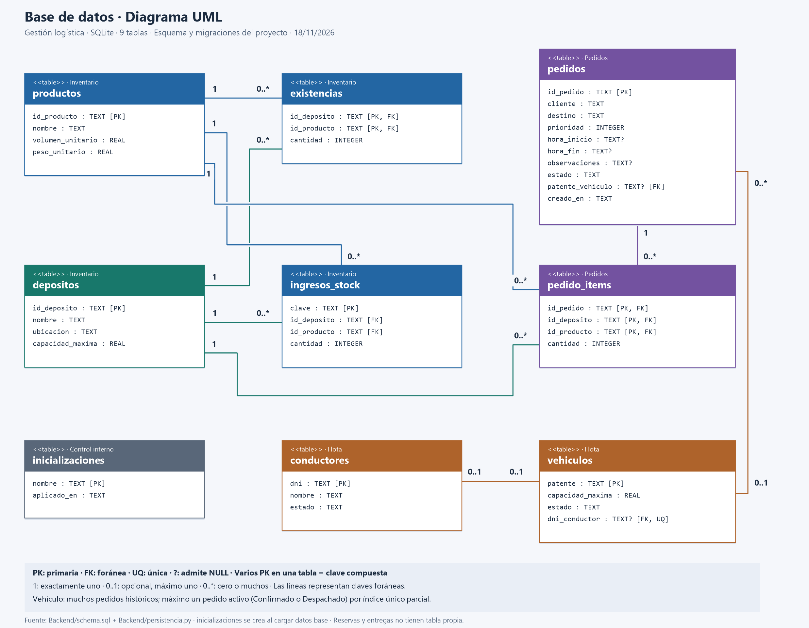
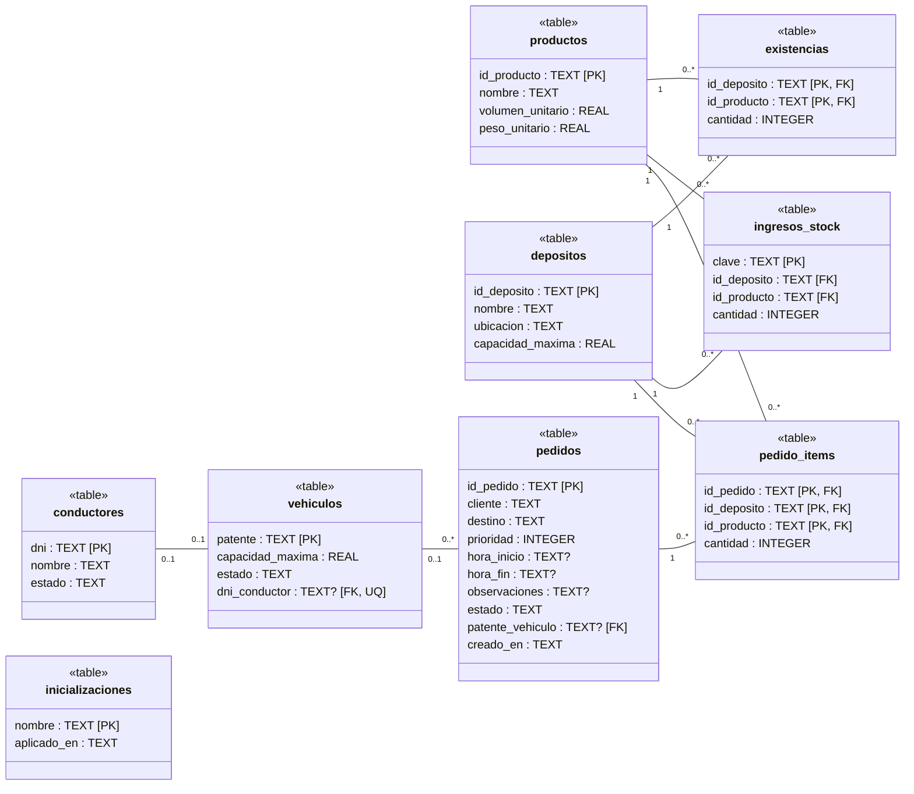

# Diagrama UML de la base de datos

[Índice de documentación](../README.md) · [Guía para defender las relaciones](guia-defensa-base-datos.md)

Fecha de revisión: 18/11/2026.

El proyecto utiliza **una base SQLite**, cuyo archivo predeterminado es `Backend/logistica.db`. Inventario, pedidos y flota comparten sus tablas. La consola permite elegir otro archivo con `--db` y la API mediante `LOGISTICA_DB` o el argumento `ruta_db` de `create_app`.

Este es un diagrama de clases UML aplicado al esquema relacional: cada clase representa una tabla y cada asociación representa una clave foránea. Refleja `Backend/schema.sql` y las migraciones de `InventarioSQLite` en `Backend/persistencia.py`.

## Imagen del diagrama

[Abrir versión vectorial ampliable](diagrama-base-datos.svg).

**Leyenda:** `PK` = clave primaria; `FK` = clave foránea; `UQ` = valor único; `?` = admite `NULL`. Los campos sin `?` son obligatorios. Varios campos marcados `PK` en una misma tabla forman **una sola clave primaria compuesta**. Las multiplicidades describen lo permitido por el esquema: `1`, exactamente uno; `0..1`, opcional y como máximo uno; `0..*`, cero o muchos.

## Fuente editable en Mermaid

## Qué guarda cada tabla

| Tabla | Responsabilidad |
|---|---|
| `productos` | Catálogo: nombre, volumen y peso de una unidad. |
| `depositos` | Ubicación y capacidad máxima de cada depósito. |
| `existencias` | Cantidad física de un producto en un depósito; una fila por pareja. |
| `ingresos_stock` | Claves de operación y datos de ingresos para reintentar sin duplicar una carga. No es un historial de todos los movimientos de stock. |
| `pedidos` | Cliente, destino, prioridad, horarios, observaciones, estado, vehículo e instante de creación. |
| `pedido_items` | Cantidad de cada producto que un pedido solicita a un depósito. Permite obtener el mismo producto desde distintos depósitos. |
| `conductores` | Identidad y estado persistido de los conductores. |
| `vehiculos` | Capacidad, estado y conductor asignado. |
| `inicializaciones` | Marcadores de carga inicial; evita repetir la inicialización. No tiene claves foráneas. Se crea al ejecutar la carga de datos base. |

## Relaciones y reglas que ayudan a entender el diseño

- **Productos y depósitos:** tienen una relación muchos a muchos resuelta por `existencias`. Su PK es `(id_deposito, id_producto)`.
- **Pedidos y productos:** se vinculan mediante `pedido_items`, que también identifica el depósito de origen. Su PK es `(id_pedido, id_deposito, id_producto)`. El SQL permite un pedido sin ítems; el backend exige al menos uno para confirmarlo.
- **Vehículo y conductor:** ambos extremos son opcionales y como máximo uno, porque `vehiculos.dni_conductor` admite `NULL` y es `UNIQUE`. SQLite permite que varios vehículos tengan ese campo en `NULL`.
- **Vehículo y pedidos:** un pedido puede no tener vehículo. Un vehículo puede figurar en muchos pedidos históricos, pero el índice único parcial `pedido_vehiculo_activo`, creado en `persistencia.py`, impide repetir una patente no nula entre pedidos `Confirmado` o `Despachado`.
- **Referencias:** `pedido_items` e `ingresos_stock` referencian a `depositos` y `productos` por separado. No tienen una FK compuesta hacia `existencias`. Las FK no declaran borrado ni actualización en cascada.

## Restricciones y datos calculados

| Elemento | Regla actual |
|---|---|
| Medidas | `volumen_unitario`, `peso_unitario` y `capacidad_maxima` son mayores que cero. |
| Cantidades | `existencias.cantidad` es un entero mayor o igual que cero; en `pedido_items` e `ingresos_stock` debe ser mayor que cero. |
| Prioridad | Entero entre 1 y 3. |
| Estado del pedido | `Borrador`, `Confirmado`, `Despachado`, `Entregado`, `Cancelado`; valor inicial `Borrador`. |
| Estado del vehículo | `Disponible`, `En Ruta`, `Mantenimiento`; valor inicial `Disponible`. En mantenimiento no puede tener conductor; en ruta debe tenerlo. |
| Estado del conductor | En SQL se guarda `Disponible` o `Inactivo`, inicialmente `Disponible`. El backend puede mostrar `Asignado` al derivarlo de su asociación con un vehículo. |
| Fechas automáticas | `pedidos.creado_en` e `inicializaciones.aplicado_en` usan `CURRENT_TIMESTAMP` de SQLite, en UTC. |
| Reservas | No hay tabla de reservas: se suman las cantidades de ítems de pedidos `Confirmado`. Confirmar reserva; despachar descuenta stock físico. |
| Totales | El stock disponible, el volumen ocupado del depósito y el volumen total del pedido se calculan; no son columnas. |
| Entregas y clientes | No existen tablas `entregas` ni `clientes`. El cliente se guarda como texto en `pedidos`; el objeto Python `Entrega` se reconstruye desde los datos y el estado del pedido. |

## Fuentes

- [Esquema SQL](../../Backend/schema.sql): tablas, claves, restricciones y datos base.
- [Persistencia](../../Backend/persistencia.py): migraciones, índice de vehículo activo y cálculos de inventario.
- [Pedidos](../../Backend/pedidos.py): reservas, transiciones y reconstrucción de entregas.
- [Flota](../../Backend/flota.py): asignaciones y estados derivados.
- [Inicio de consola](../../Backend/main.py) y [API](../../Backend/api.py): selección del archivo SQLite.

## Verificación

Se contrastaron las nueve tablas, sus 38 campos, claves, nulabilidad y nueve relaciones con una base en memoria creada mediante `InventarioSQLite`. También se revisó `Backend/logistica.db` en modo de solo lectura: sus campos y relaciones coinciden; el orden físico de algunas columnas de `pedidos` difiere por las migraciones. Se comprobó la existencia del índice único parcial y se revisó visualmente la imagen.

La documentación describe el esquema implementado; no incluye datos de clientes ni registros de la base de trabajo. No se ejecutaron pruebas funcionales de la aplicación para este cambio de documentación.
